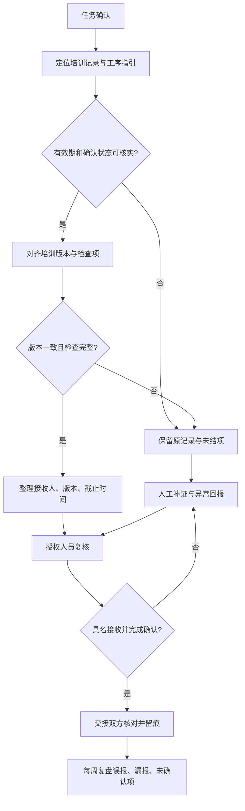

# 现场调研分析报告

项目：生产岗位培训与工序交接｜FDE课堂作业2｜2026-11-05（北京时间）

资料性质：训练平台合成案例。下文的“已采集”指角色模拟访谈已记录，不代表真实企业事实、现场观察、授权或客户签收。

## 核心发现

本次“现场”指虚拟业务实验室，没有到访真实工厂。根据六角色问答，最值得验证的是：培训、指引与交接没有共同的版本及确认链，简写“已完成”又隐藏了接收人和未结项，导致异常需要事后回查。群消息先处理、表格后补填，使回填时间不能用于还原事件顺序（f13）；跨系统无统一关联编号增加核对难度（f30）。

这是证据支持的问题假设，尚不能把“系统老旧”“员工不认真”或“缺少AI”认定为根因。缺少真实原单、变更日志、现场计时和接口权限材料；完整因果链还需交叉核验。

## 模拟事件复盘

已采集事件：工序检查项新增→夜班沿用旧清单→漏记一项复核→回查原始版本才能判断责任（f11）。已知结果是复核链存在信息缺口；具体发生日期、交接包ID、影响数量、停工或质量损失均未核实。f12披露的160次交接、6小时回查属于另一个虚构演练基线口径，不能与单次异常强行关联为真实损失。

## 现状流程与异常路径

下表将角色描述的五段主链展开为10个分析步骤；未获证据的细节明确保留为待核实，不把分析性拆分当成现场观察。

| 步骤 | 角色/行为 | 输入与输出 | 判断或执行 | 异常与接手 | 依据 |
|---|---|---|---|---|---|
| 1 任务确认 | 业务侧确认工作；具体发起单待补 | 任务→待处理交接包 | 人工判断 | 范围不清交顾明岚确认 | f01/f04 |
| 2 资料定位 | 现场人员取培训材料和工序指引 | 文件/台账→适用资料 | 执行；入口与维护者待补 | 资料缺失由唐映秋协调 | f10/f21/f30 |
| 3 版本确认 | 核对有效期和确认状态 | 候选版本→适用版本 | 人工判断 | 冲突保留原版、挂未结项 | f24/f25 |
| 4 培训记录核对 | 现场人员核对培训确认 | 培训记录→确认或待核实 | 人工判断 | 缺失与未确认分开标记 | f14/f31 |
| 5 工序检查记录 | 按清单记录检查项 | 现用清单→工序记录 | 执行；实际动作待观察 | 夜班旧清单/漏记进入异常 | f11 |
| 6 交接包整理 | 协调员列版本、接收人、未结项、截止时间 | 记录→交接包 | 执行 | 不允许仅发“已处理” | f20/f23 |
| 7 异常沟通 | 现场先群消息处理，再回填 | 异常→沟通及补填记录 | 执行 | 保留发生/接收/回填时间 | f13/f34 |
| 8 异常责任登记 | 资料负责人保存确认链 | 差异→具名未结项 | 人工判断 | 不把未确认项算给对方 | f25 |
| 9 质量复核 | 授权复核人看版本、来源、异常 | 交接包→复核意见 | 人工判断 | 无法确认进入人工队列，必要时暂停 | f41/f42/f44 |
| 10 接收与反馈 | 接收双方核对数量、状态、截止时间 | 复核意见→签收/待补/投诉 | 人工判断后执行 | 叶书登记问题与恢复需求，按周复盘 | f53/f54/f55 |

图中“具名接收”及检查节点是基于访谈的分析表达；真实系统泳道、审批表单和最终接收人仍待确认。没有自动审批或生产放行路径。

## 瓶颈、潜在根因与验证

| 观察到的线索 | 潜在机制（待验证） | 替代解释 | 必须补的材料 | 跟进建议 |
|---|---|---|---|---|
| 旧清单漏新增项（f11） | 版本分发与培训确认未同步 | 清单已同步但培训/执行未留痕 | 指引修订前后版、通知与培训记录 | 唐映秋+林亦舟 |
| 交接仅记已完成（f10） | 模板缺关键字段或实际未使用 | 字段存在，但统计只导出摘要 | 原始表单、导出字段、样例截图 | 唐映秋+秦芮 |
| 群消息先行（f13） | 即时协作与系统回填脱节 | 仅异常时使用，不是普遍习惯 | 同一单消息时间、发生/回填时间 | 林亦舟+秦芮 |
| 无统一关联编号（f30） | 多源记录难以归并同一包 | 可能有未公开映射字段 | 只读字段字典、重复与错配样本 | 秦芮 |
| 速度与复核窗口冲突（f50） | 完成口径不一致 | 岗位目标不同但流程已处理冲突 | SLA、质量复核规则、退回日志 | 叶书+傅景 |

## 四来源收敛

| 来源 | 已获得 | 能支持什么 | 缺口与结论 |
|---|---|---|---|
| Buyer | 顾明岚f00/f02/f03/f04/f05 | 目标、一个批次、四周投入约束、演练验收、决定链 | 预算金额、实际出资与具名签字未证实；部分收敛 |
| Brief | 平台客户简报与公开场景说明 | 训练问题及只读边界 | 没有真实客户签署Brief原文、版本与验收条款；未完成 |
| Industry | 本作业本地规则原型及测试 | 只能证明当前替身逻辑可执行 | 没有可比行业实施案例、真实数据和接口证据；本地测试不能充当行业验证 |
| Operator | 林亦舟f10/f11/f12/f13/f14 | 具体模拟异常、虚构基线、时间口径和原值保护 | 最近真实一单的原始单据与计时未取得；部分收敛 |

六角色访谈不等于四来源齐备；目前只支持一个有条件的需求假设，不能写成需求、预算、授权均已确认。

## 分歧及处理

1. **速度与质量：** 生产协调追求快速交出，质量需要复核窗口。用总时长、主动工时、等待、返工与确认完整率共同评估，不以“更快”覆盖复核（f50/f51）。
2. **形式完成与业务确认：** 勾“已完成”不能证明版本、培训、接收与异常已确认；将各状态分开，正式决定由授权人作出（f10/f22/f41）。
3. **文件名与有效版本：** 以有效期和确认状态核对，作废理由与原版保留，不按文件名猜最新（f24）。
4. **角色说法与原始依据：** 多角色一致陈述仍是模拟陈述。保留不同口径、补原单和制度，不替角色改口。
5. **基线前后披露：** 早期“不掌握真实数据”与后续“演练160次、6小时”分别记录。不能据后者宣称真实节省多少小时。

## 候选需求与责任追溯

| REQ | 谁在何时需要什么 | 输出与失败控制 | 证据 | 业务负责人建议 |
|---|---|---|---|---|
| REQ-1 | 现场交接时核对培训与有效指引版本 | 差异清单；冲突或未确认转人工 | f10/f11/f24 | 唐映秋+傅景 |
| REQ-2 | 协调员核对检查项、接收人与未结异常 | 缺项/待确认分开，不覆盖原值 | f20/f23/f31/f14 | 唐映秋 |
| REQ-3 | 具授权身份只读查询本批次 | 作用域拒绝、零业务写入 | f05/f32/f41 | 顾明岚+秦芮 |
| REQ-4 | 质量复核查看每条建议依据 | 来源、版本、采集时间、规则、人工状态 | f42/f43/f45 | 傅景 |
| REQ-5 | 故障、过期或重复运行时保持可回退 | 历史快照标时间，停结论并转人工；无重复业务执行 | f34/f35/f44 | 秦芮 |
| REQ-6 | 处理格式错误与不支持字段 | 失败关闭，原始记录不变 | f31/f33 | 秦芮 |
| REQ-7 | 识别超出只读范围的请求 | 拒绝建议动作；没有设备/审批执行接口 | f05/f22/f52 | 傅景 |

以上是待确认需求，已在课堂原型中验证部分规则；缺少真实角色UAT、真实接口、授权人员签字及持久审计。详见[需求与方案](项目交付/需求与方案.md)。

## 下一步与关卡意见

先补真实Brief、匿名原单、版本有效性、映射字段和权限清单；按同口径采集基线，再开展一个批次四周试点。建议由林亦舟执行、唐映秋协调、秦芮支撑、傅景复核、顾明岚定范围、叶书确认用途。后四项确认型访谈（07-2、08-1、08-3、09-2）应在客户会议/事件通道分别记录，不能用本次发现型访谈替代。

本阶段交付了流程、证据、分歧和补证计划；真实现场调研与四来源验证尚未闭环。课堂报告可审阅，正式需求确认及上线关卡待评审。
