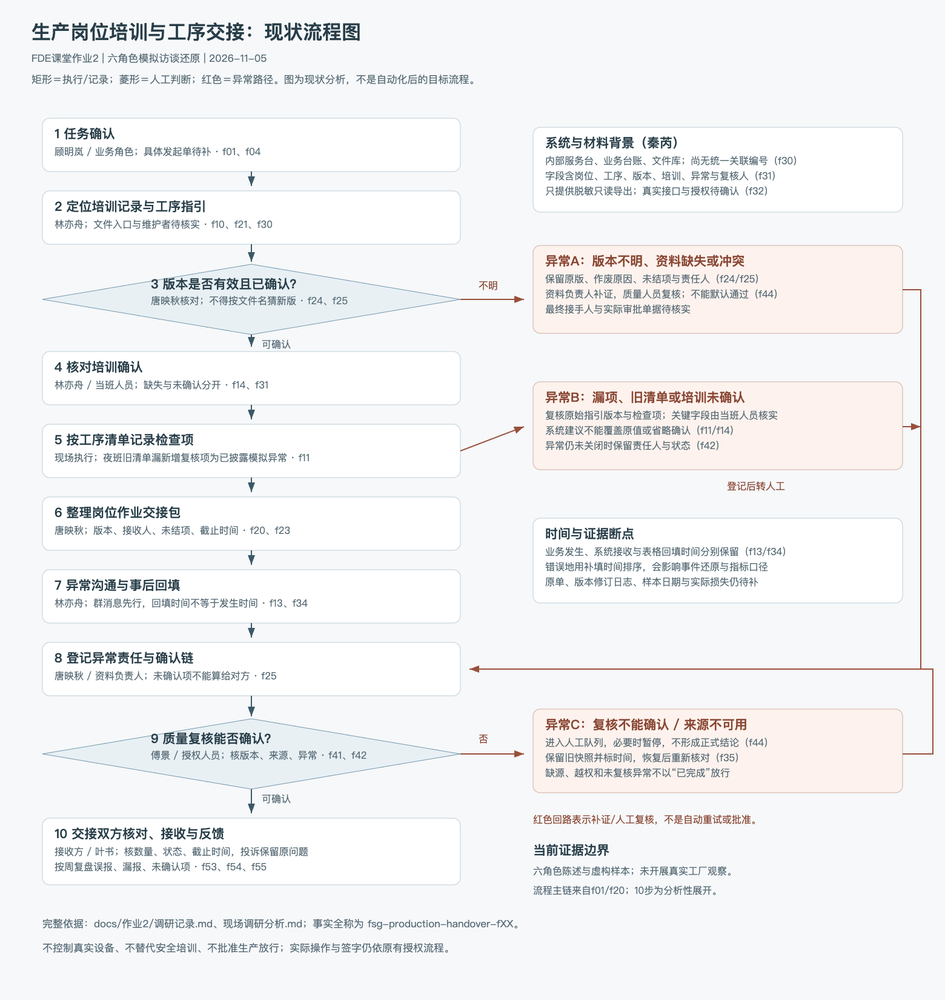
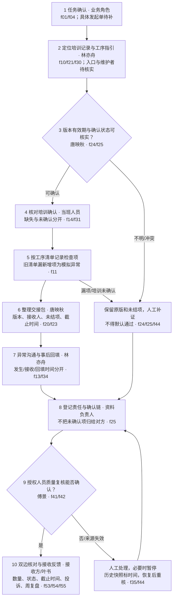

# 现状流程图

FDE课堂作业2｜生产岗位培训与工序交接｜2026-11-05

[打开SVG流程图](现状流程图.svg)。以下为可编辑的Mermaid版本。该图还原虚拟实验室角色陈述，10个步骤是基于五段主链的分析展开，未声称现场已观察到所有细节。

## 阅读说明

矩形表示执行或记录，菱形表示人工判断。红色异常路径见图片/SVG。岗位、系统与确切接手人未确认的部分必须补原始单据，不能由图示推定真实责任。版本核对、异常责任、正式签收和生产放行不能由模型替代。

完整10步表、四来源和分析见[现场调研分析](现场调研分析.md)，原话与证据见[调研记录](调研记录.md)。所有事实编号的完整前缀为`fsg-production-handover-`。
