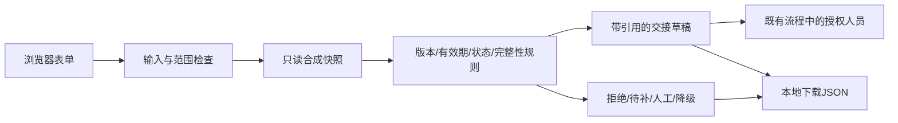

# 需求与方案

FDE课堂作业2｜生产岗位培训与工序交接｜2026-11-05

## 方案取舍

沿用平台离线源码的工作台、证据、审计、评估四个视图，替换通用演示逻辑。所有非本项目产品配置已从runtime移除。没有接入LLM或真实系统，界面中的“智能体”是三个确定性处理节点，不宣称多模型协作。

| 候选 | 价值假设 | 失败后果与恢复 | 本轮决定 |
|---|---|---|---|
| 人工优化模板 | 低投入补齐版本、接收人、未结项 | 依赖填写一致性，人工可纠正 | 保留为对照 |
| 规则核对与只读草稿 | 对相等、状态、缺项、有效期给出可复现差异 | 停止结论、保留原值、人工复核 | 选用 |
| 检索与模型起草 | 可能帮助定位长文档与整理语言 | 错误概括或引用，新增评估成本 | 缺价值证据，暂缓 |
| 自动写回与生产放行 | 不属于授权范围 | 可能产生不可逆业务后果 | 排除 |

## 输入、输出与异常契约

`runProjectDemo(projectId, input, modules)`是唯一规则入口。项目仅允许`fsg-production-handover`；固定合成交接包`HND-DEMO-001`；授权演示身份`operator`。下拉身份只用于测试，生产鉴权必须服务端实现。

| 输入 | 类型、约束 | 作用 |
|---|---|---|
| scenario | 已定义场景枚举；省略为normal | 对克隆后的合成快照注入故障，不改变原始fixture |
| identity | 必须明确为operator | 其他或未提供身份在读取来源前拒绝 |
| moduleId / recordId | 指定时须匹配当前模块/固定样本 | 防止跨范围演示 |
| mode | 仅offline | 独立作业没有在线模型接口 |
| request | 1–2000字字符串；省略使用示例任务 | 拦截部分明确越界意图；其余文字也没有执行接口 |
| trainingVersion | 不超过80字字符串 | 与指引版本比较；空值为缺失 |
| trainingState | confirmed / unconfirmed / missing | 已确认、未确认、缺失分开 |
| completedItems | 不超过20项的字符串数组 | 与必查项C01/C02做集合覆盖核对 |
| receiver | 不超过80字字符串 | 空值为缺失；仅演示名称，不证明正式授权 |

未知字段拒绝。输入为null、数组、非法类型时拒绝。只读fixture包含岗位、工序、批次、指引版本及状态、有效期、培训确认、检查项、异常责任人、来源版本、采集时间、核对时间。合成时间固定，60分钟阈值只是教学假设；真实更新频率和阈值未确认。

输出状态：`review`待人工复核、`needs-info`待补资料、`manual`人工核对、`blocked`拒绝、`degraded`故障降级。每条输出含规则版本、来源位置/版本/时间、处理轨迹、待确认责任、`writes=0`、`externalSends=0`、`approval=未获人工批准`。这些字段对应实际只读实现，不是已执行过真实授权审批的证据。

## 架构与Ontology

岗位参与批次的工序；工序对应带有效期和确认状态的指引版本；培训记录引用版本；交接包关联培训、检查项、异常、交出/接收角色；异常保留责任人与状态；核对结果引用来源快照和规则版本。正式确认关系由原系统授权人员建立，本原型不创建审批关系。

## 权限及人工责任矩阵

| 角色 | 原型可做 | 正式项目需要补的授权 |
|---|---|---|
| 经办人（演示operator） | 读取本样本、运行规则、导出本地JSON | 服务端身份、记录级范围、数据用途 |
| 访客/其他身份 | 不能读取来源 | 没有以客户端参数授权的路径 |
| 唐映秋对应协调角色 | 建议核对版本和未结项 | 资料维护权与具名接收人 |
| 傅景对应质量角色 | 文档中建议负责复核与叫停 | 实际权限清单、签字与停止记录 |
| 模型 | 本轮未调用 | 无审批、设备、业务写入权限 |

故障无业务重试。重复运行是纯函数，不创建或重复执行工单；这不能替代未来写接口的服务端幂等键。JSON导出不是持久审计库，刷新会清空页面历史；真实访问记录、确认链、脱敏与留存删除仍需建设。

## 需求—实现—测试追溯

| REQ | 证据编号后缀 | 实现 | 自动/场景验证 | 剩余差距 |
|---|---|---|---|---|
| REQ-1 版本有效性 | f10/f11/f24 | runtime.js版本、有效期与确认状态核对 | conflict、invalid-rule、输入版本测试 | 真实指引版本源与补训判定 |
| REQ-2 完整性 | f20/f23/f31 | 培训状态、接收人、检查项、异常 | missing、unconfirmed、missing-item、open-exception | 截止时间、真实人员名单、动态清单 |
| REQ-3 只读范围 | f05/f32/f41 | 身份白名单、模块与样本范围 | unauthorized、module-boundary、invalid-identity | 服务端登录与记录级权限 |
| REQ-4 追溯 | f42/f43/f45 | 来源快照、版本、时间、规则和导出 | 来源断言；浏览器JSON导出 | 持久访问审计、真实确认人 |
| REQ-5 降级与重复 | f34/f35/f44 | 故障停结论、过期转人工、fixture隔离 | outage、stale、重复深相等 | 真实网络超时、历史快照存储 |
| REQ-6 数据契约 | f31/f33 | 输入类型与未知字段拒绝 | bad-items、bad-state、unknown-field | 多条导入、重复编号/空时间/单位质量检查 |
| REQ-7 动作边界 | f05/f22/f52 | 无执行接口，部分越界语言显式拦截 | injection与越界自然语言 | 接模型后的完整工具权限与对抗评估 |

证据全称均为`fsg-production-handover-fXX`。首版实现覆盖上述课堂子集，不声称完成所有业务需求。

## 报价与ROI演算

没有真实报价或金额预算。以下仅为课堂试算报价：一次性实施4000元（单批次字段映射、只读原型、测试、手册），运行支持200元/月（维护与故障复核预留）；不含真实系统改造、生产部署、模型调用和现场安全培训。必须重新取得正式报价与采购确认。

依据虚构样本f12，160次交接共回查6小时。假设回查下降50%、人力100元/小时、节省工时兑现率50%，则每同规模批次可兑现收益为6×50%×100×50%=150元。真实批次数、节省比例、单价和兑现率均未知。

令月批次数为B：月收益=150B；首年收益=1800B；首年成本=4000+200×12=6400；首年净收益=1800B−6400；首年ROI=(1800B−6400)/6400。月净收益=150B−200，仅为正时回本期=4000/(150B−200)。

| 假设月批次数 | 年净收益 | 首年ROI | 回本期 |
|---|---:|---:|---:|
| 2 | -2800元 | -43.75% | 40个月 |
| 4 | 800元 | 12.50% | 10个月 |
| 6 | 4400元 | 68.75% | 5.71个月 |

首年盈亏平衡需要B≥3.56批/月（按相同规模的虚构批次）。这不是建议客户投入的财务结论，不能把释放工时自动等价为现金节约。试点后必须按实际工时、误报复核、采用率、维护费用重算，并区分效率收益与可兑现收益。
