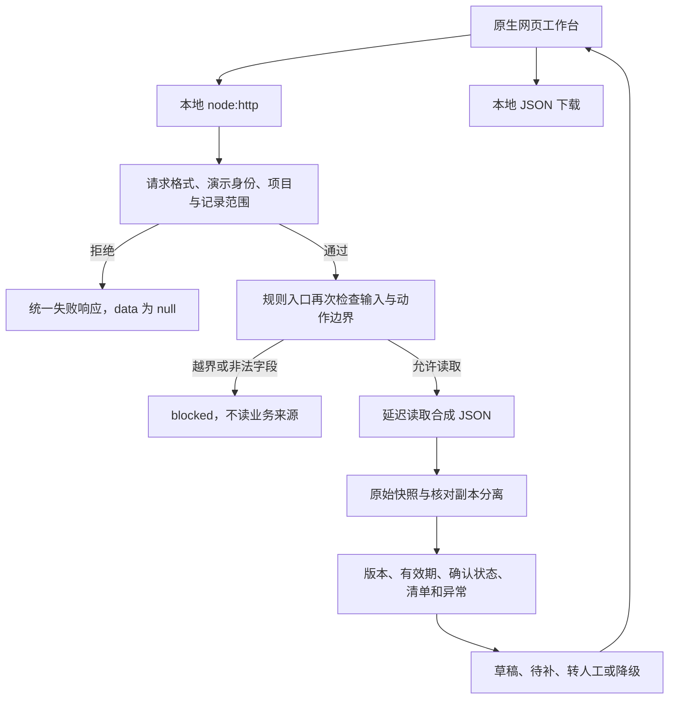

# 第一阶段技术栈与架构

> 第一阶段文档归档：作业3已新增本地复核记录、配置和接口，当前说明见[作业3方案](../../../作业3/doc/人工复核记录与追溯方案.md)与[接口字典](../../../作业3/doc/接口与数据字典.md)。

本阶段将原浏览器规则原型迁移为本地服务核对，集中运行配置，保留合成来源与原有工作台。项目范围为一个批次、一个模块、一个合成交接包；不连接真实企业系统，不调用模型。

## 固定技术栈

| 层次 | 技术 | 用途与边界 |
|---|---|---|
| 运行时 | Node.js ≥22 | 原生 ESM，无构建工具 |
| 页面 | HTML、CSS、JavaScript | 沿用已有侧栏、表单、结果、证据、轨迹与评估视图 |
| 服务 | `node:http` | 静态资源白名单、三个业务 API、服务端权限与范围检查 |
| 文件 | `node:fs/promises` | 只读合成 JSON；验证脚本单独写证据目录 |
| 配置 | `config.yaml`、`yaml@2.9.1` | 唯一运行配置；yaml 为唯一第三方运行依赖，精确锁版 |
| 数据 | `data/handover.json` | 独立合成快照，每次核对创建副本 |
| 测试 | `node:test`、`node:assert/strict` | 规则回归、真实 HTTP 集成和数据不变性验证 |
| 验证辅助 | `node:events`、`node:crypto`、`node:child_process` | 服务生命周期、SHA-256、运行本机测试 |
| 导出 | 浏览器 Blob、JSON | 仅下载当前结果，不调用发送接口 |

不使用前后端框架、Agent 框架、数据库、向量库、Redis、队列或容器编排。没有外部模型地址、模型密钥或推理代码；因此目前也没有需要注入的密钥环境变量。

原生 HTTP 的使用方式参考 [Node.js 22 官方文档](https://nodejs.org/docs/latest-v22.x/api/http.html)；配置解析参考 [yaml 官方文档](https://eemeli.org/yaml/)。配置解析禁止重复键及别名展开。

## 模块职责

| 文件 | 职责 |
|---|---|
| `config.yaml` | 项目、服务、授权演示范围、数据位置和规则阈值 |
| `config.mjs` | 读取及验证配置，创建权限通过后才调用的数据读取器 |
| `data/handover.json` | 独立保存原始合成快照，不保存运行阈值 |
| `runtime.js` | 输入契约、范围检查、版本和完整性规则、领域结果、17 场景评估 |
| `response.mjs` | 成功和失败的统一接口结构 |
| `server.mjs` | 本机 HTTP 路由、服务端授权、来源读取顺序及静态白名单 |
| `app.js` | 表单、同源 API、业务状态展示、内存轨迹和本地下载 |
| `demo.test.mjs` / `server.test.mjs` | 规则和 HTTP 集成测试 |
| `smoke.mjs` | 自启临时回环服务，直接验证 HTTP 场景 |
| `verify.mjs` | 运行测试、五轮评估、源码哈希并保存新证据 |

## 运行路径

`GET /api/state` 同样先验证身份，再读取默认表单数据。服务创建和配置读取不会预读业务样本。禁止通过静态路径获取 YAML、JSON、运行源码或依赖目录。

## 三个处理节点

1. 范围与身份核对：先检查输入白名单，再检查演示身份、项目、模块、记录和动作边界。
2. 版本与完整性核对：检查时间是否可解析、有效期顺序、时效阈值、指引确认状态、培训版本、检查漏项、接收人与未结异常。
3. 人工交接草稿：仅在规则满足时输出 `review`；`reviewStatus=pending`，`approval=未获人工批准`。

模型无法决定权限，因为本阶段没有模型调用。自然语言拦截只辅助识别已知越界语句；真正的动作限制来自根本不存在业务写入、设备和发送接口。

## 关键设计决定

- **配置迁移**：移除 `project.json`，原项目编号、练习编号、模块及需求追溯信息迁入 YAML；旧训练链接只存档，不导航或联网。
- **调用迁移**：内部 `runProjectDemo(projectId, input, context)` 现在返回 Promise，context 显式包含 config 和 readSnapshot；旧 modules 数组签名和浏览器直接调用路径已移除。
- **演示权限**：服务端检查 `X-Demo-Identity` 与任务身份一致，固定白名单为 operator；它们都可由调用者自报，不能被解释为真实登录凭证。
- **来源真实性**：证据引用原始 JSON 的位置、版本和采集时间；场景故障、版本输入及清单修改只作用于副本，不冒充来源事实。
- **历史时间**：以样本中的 `reviewedAt` 执行可复现演练，而非使用当前时间证明真实业务状态；60 分钟只是可配置教学假设。
- **敏感输入**：不保存或回显任务原文；接收人仅接受合成名称，版本和检查项仅接受合成编号；不收集真实员工信息。
- **人工责任**：本阶段展示待复核状态，未实现人工意见持久记录或签字，不提供“批准”按钮。
- **副作用口径**：`writes=0` 指业务系统写入为零，`externalSends=0` 指外部业务发送为零；本机 HTTP 响应、本地下载及显式验证证据写入不属于业务写回。

## 下一阶段前置缺口

真实身份、记录级授权、人工意见审计链、留存与删除策略、真实系统接入均未实现。不得把该本地合成原型用于正式数据或公网部署。
