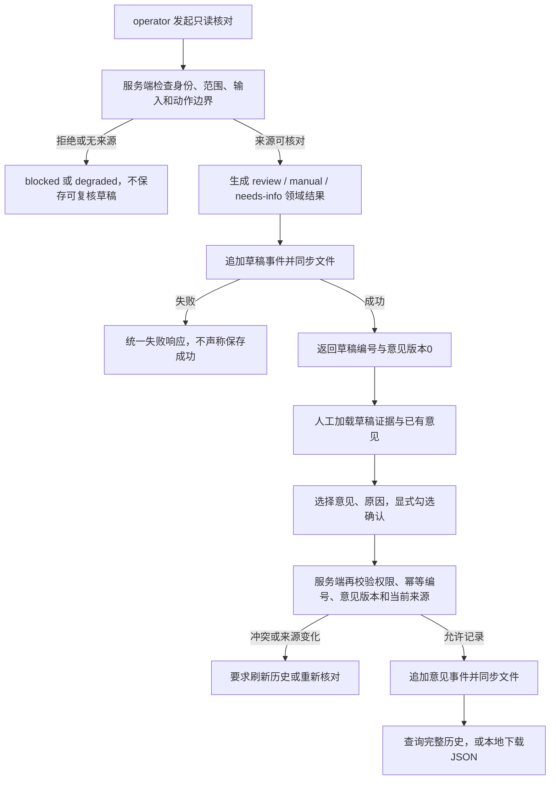

# 作业3方案：人工复核意见记录与追溯

版本：1.0｜阶段：第二阶段｜日期：2026-11-12（北京时间）

## 一、背景与交付目标

作业2第一阶段已经实现服务端范围与身份检查、版本和完整性核对、带来源的人工交接草稿及统一接口。但页面刷新后不能恢复草稿，没有人工意见的持久记录，也无法证明一条意见对应哪次规则结果。

本阶段在原项目内补齐“草稿保存—人工查看—意见记录—历史追溯—本地导出”链路。所有输入和案例仍为合成演练，范围固定为项目 fsg-production-handover、模块同名、交接包 HND-DEMO-001。目标是验证本地记录机制，不代表客户 UAT、真实培训确认或生产上线。

## 二、固定技术栈

| 层次 | 技术 | 实际用途 |
|---|---|---|
| 运行环境 | Node.js ≥22 | 原生 ESM，无构建或应用框架 |
| 页面 | HTML、CSS、JavaScript | 沿用工作台，增加人工复核记录区 |
| 服务 | node:http | 原接口和三个复核路由，统一成功/失败外壳 |
| 文件 | node:fs/promises | 延迟读取合成来源，追加 JSONL 日志与同步落盘 |
| 配置 | config.yaml、yaml@2.9.1 | 单一配置入口，唯一第三方依赖不变 |
| 指纹与编号 | node:crypto | SHA-256、UUID v4，无密钥、无模型 |
| 自动验证 | node:test、node:assert/strict | 规则、HTTP、重启恢复、冲突及故障测试 |
| 持久记录 | 本地 JSONL | 一个事件一行，不引入数据库或队列 |
| 导出 | 浏览器 Blob、JSON | 下载当前草稿的完整追溯视图 |

源码继续在 `作业2/src` 迭代；作业3方案放在 `作业3/doc`。原生文件句柄同步能力参考 [Node.js 22 文件系统文档](https://nodejs.org/docs/latest-v22.x/api/fs.html)，哈希和编号参考 [Node.js 22 crypto 文档](https://nodejs.org/docs/latest-v22.x/api/crypto.html)。

## 三、业务边界与角色

本阶段只有 operator 演示身份可以核对固定样本、查询历史及记录合成复核意见。其他六个业务角色仍是责任分工，不自动获得账号或系统权限。

operator 和 X-Demo-Identity 都是客户端可声明值，服务端执行白名单与记录范围检查，但没有真实登录。记录中的 reviewer=operator 仅表示演示身份，不表示质量负责人已经具名签字；现有原型也没有双人复核或职责分离保证。

可记录三类意见：

| 编号 | 页面措辞 | 含义 |
|---|---|---|
| acknowledged | 已人工核阅资料 | 记录对该草稿的查看意见，不代表同意生产 |
| needs-info | 要求补充资料 | 保留原始核对结果，要求按既有流程补证 |
| escalated | 转人工协调 | 保留问题，由既有授权人员进一步核实 |

原因使用预定义代码和中文标签，不接收自由文字、真实姓名、联系方式、密钥或附件。若发现需要自定义文本的实际需求，应另行设计脱敏、授权及留存规则，本阶段不直接放开。

## 四、流程与状态



业务核对状态与意见记录状态分开：原 result.status 始终保留；没有意见为 pending，记录意见后投影为 opinion-recorded。人工记录不会把 manual 改成 review，也不会补齐培训、关闭异常或修改来源数据。

每次保存前必须手动选择意见和原因，并勾选“我已人工查看本草稿，理解记录意见不会批准或放行”。页面不默认勾选；HTTP 入口和存储入口均验证 acknowledgement=true，但该布尔值仍不是正式签名或身份凭证。

## 五、记录模型与可追溯关系

日志仅包含两类事件：draft-created 和 opinion-recorded，不提供修改、删除或 approve 事件。

草稿事件保存服务端 UUID、原规则结果、来源 SHA-256、结果 SHA-256，以及白名单合成覆盖值。自由任务原文和请求头不写入文件。来源引用仍是原始合成 JSON，用户的版本、检查项或场景覆盖单独保存，不冒充来源事实。

意见事件保存 reviewId、draftId、revision、previousReviewId、operationId、reviewer、opinion、reasonCodes 和人工确认值。时间与全局事件序号由服务端生成，客户端不能提供签名、时间或审批状态。

每条事件外壳包含 seq、previousHash、type、createdAt、data、hash。hash 对前五个字段的 JSON 计算 SHA-256，并通过 previousHash 链接前一条事件；每次读写前验证完整链、原结果指纹、来源指纹及意见关联。

## 六、并发、重试与持久化

- **同实例串行**：Promise 队列串行处理文件事务，失败只返回原调用者，后续请求仍可检查日志。
- **跨实例互斥**：创建排他短时锁文件；已被其他实例占用或崩溃遗留时返回 AUDIT_BUSY，不自动删锁。
- **版本冲突**：客户端提交 expectedRevision；已有新意见时返回 REVISION_CONFLICT，人工加载最新历史后重新决定。
- **重复提交**：operationId 为 UUID；同一编号和同一意见重试返回既有记录，localAuditWrites=0；相同编号绑定其他内容返回 IDEMPOTENCY_CONFLICT。
- **来源绑定**：新增意见前重新读取当前合成来源，与草稿来源指纹及规则版本比较；变化返回 DRAFT_STALE，要求重新核对。
- **落盘确认**：使用追加模式和文件句柄 sync；只有成功完成后才返回已保存。半写尾行、非法日志或写盘失败均返回错误，不覆盖旧事件。
- **容量边界**：默认 2 MiB、1000 事件，满额停止追加，不自动删记录或轮转。列表只展示最近50份草稿，按 UUID 查询仍可访问同文件内旧草稿。

幂等重放明确返回“已保存操作的历史响应”，不重新确认当前来源。即使重试时来源已不可用，返回的也是原意见记录，并非一次新的有效性判定。

## 七、数据红线

1. 仅使用现有合成样本和固定演示人员名称，不接入真实员工、客户或生产数据。
2. 不增加模型、数据库、外部存储、消息服务或业务网络请求。
3. 原始 JSON、培训记录、指引版本、检查项及异常保持不变，只修改独立核对副本。
4. 原业务 writes=0、externalSends=0、approval=未获人工批准持续保留；localAuditWrites 单独统计本地草稿或意见事件写入。
5. 结构化意见不包含自由文本、密钥、访问令牌或真实人员信息。
6. 配置、原始数据、审计 JSONL、锁文件及服务端源码都不能通过静态 URL 下载；日志读写先检查服务端演示权限。
7. 历史查询保留旧草稿，不能用历史快照替代当前状态；新增意见时来源不可用则停止。
8. 默认运行日志和浏览器操作记录不提交 GitHub；公开的方案、测试和验证摘要只包含合成内容。
9. 不提供生产放行、培训批准、设备控制、自动发送、异常关闭或审批接口。

## 八、失败策略与能力限制

| 情况 | 行为 |
|---|---|
| 未勾选确认、未知意见或自由文字 | 400 拒绝，既不读日志也不写意见 |
| 未授权或跨样本 | 403 拒绝，不读来源和日志 |
| 已有新版本、操作编号冲突、来源或规则变化 | 409，人工刷新或重新核对 |
| 日志损坏、半行、读写失败或锁占用 | 503，不用空历史或伪成功兜底 |
| 初始化来源失效 | 保留原接口的来源失败行为 |
| 来源变化后的历史查看 | 仍可查旧记录，但不将旧记录当当前批准 |

哈希链可检测没有重算摘要的内容改写、内部乱序和半写尾行；当前进程还能检测自己已经见过的链头被回退。它不是数字签名，没有外部可信锚点，不能保证发现本机管理员重算整条链、重启前整链删除或完整历史前缀回滚。文件系统断电、磁盘故障和目录持久性也不构成生产级保证。

日志文件不自动删除，留存和归档仍需人工决策。遇到遗留锁，应先停止本项目服务并确认没有其他实例，备份日志及锁文件、验证日志完整性后再由维护人员处理；程序不擅自删除锁、截断日志或重建坏链。

## 九、测试与验收

本阶段验收重点包括：显式人工确认、无审批事件、来源/结果指纹、历史追加、刷新和重启恢复、同操作重试、并发版本冲突、跨范围零读取、来源变化、日志损坏、半行、容量及锁故障。

实际自动测试、浏览器验收和证据摘要见[验收与交付](验收与交付.md)及[验证摘要](验证摘要.json)。自动测试通过不代表真实用户验收或生产可用。

## 十、运行与回退

从仓库根目录执行：

```sh
npm --prefix 作业2/src ci --ignore-scripts --no-audit --no-fund # 恢复唯一锁定依赖。
npm --prefix 作业2/src start # 启动本地合成工作台。
npm --prefix 作业2/src test # 另一个终端运行全量测试。
node 作业2/src/review-smoke.mjs # 直接运行复核端到端验证，不依赖已启动服务。
node 作业2/src/verify.mjs 作业2/work-evidence/phase2 # 生成本次完整测试及哈希证据。
```

回退代码前先停止本项目服务并人工备份 var 下日志和锁文件；旧第一阶段不能读取第二阶段意见，不得因此删除日志。恢复第二阶段代码后重新验证日志及测试，再继续合成演练。
